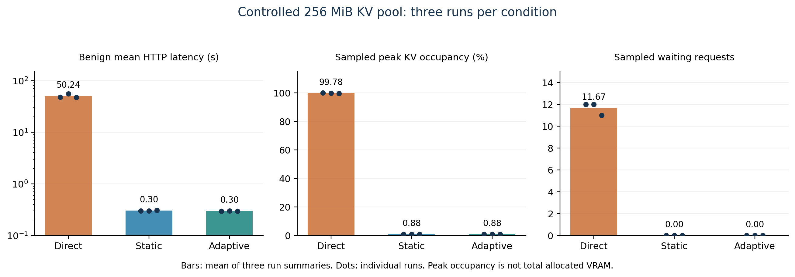
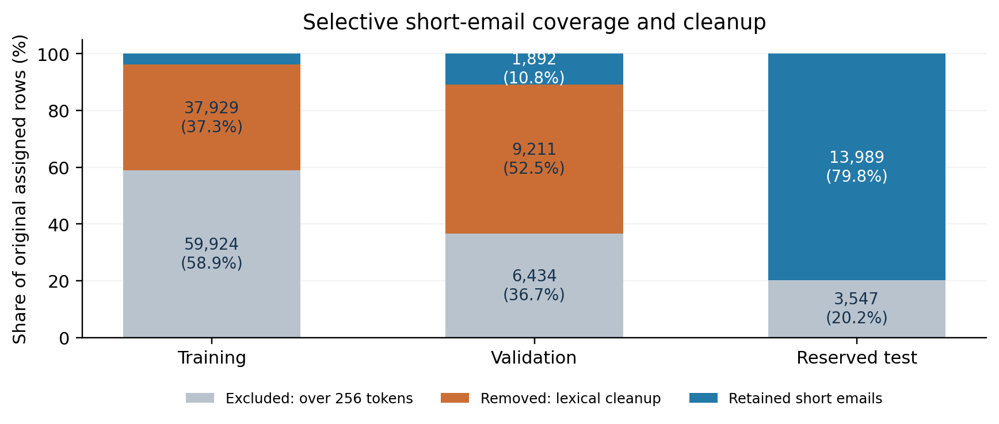
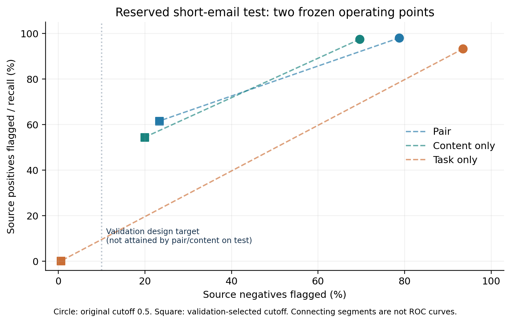
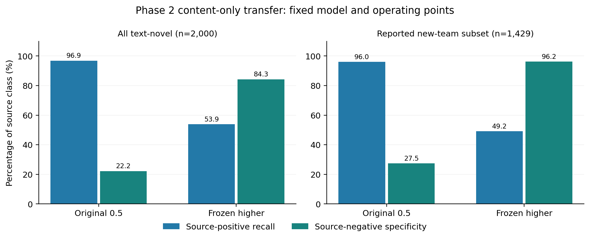
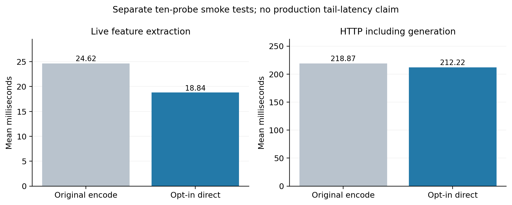

# Executive summary

This project implements a gateway in front of a GPU-backed large language model (LLM). It extracts lexical, semantic and resource-demand signals, estimates request risk, and assigns full, sandbox or quarantine execution. A Flask gateway forwards admitted requests to the OpenAI-compatible vLLM endpoint serving Qwen2.5-3B-Instruct on an NVIDIA RTX A4000. MiniLM semantic embeddings run on CUDA in FP16, and background telemetry reads actual vLLM KV-cache occupancy.

The strongest measured result is **controlled admission protection**, not general prompt-injection prevention. Across three repetitions of each of direct, static-gateway and adaptive-gateway conditions, mean benign HTTP latency averaged 50.24 seconds direct, 302 milliseconds static and 298 milliseconds adaptive. All 24 benign probes per condition completed. Direct sampled cache occupancy reached 99.56–100%; both protected conditions peaked at 0.881% and blocked all tested high-demand requests. These results use a deliberately constrained **256 MiB KV-cache pool**, eight capped generation demands and eight benign probes per run. They do not establish default-cache out-of-memory prevention, P99 latency, an incremental adaptive advantage, or monetary savings.

The injection investigation produced important negative findings. A task/content pair model scored 59/60 on a synthetic topic test but reviewed only 4/16 redirections under new wording. A subsequent public LLMail short-email experiment used exact-team-component splits, conservative lexical cleanup and frozen operating cutoffs. On 13,989 reserved source-labeled rows, the adjusted pair model achieved 61.59% source-positive recall, 76.66% source-negative specificity and 69.13% balanced accuracy. That operating point did not meet its empirical validation specificity target. The candidate remains offline.

The project therefore delivers a working resource-risk prototype, reproducible evidence and an explicit account of injection-model limitations. An offline long-email extension now covers 300 sampled emails with 723 token windows and 130,735 unique content-token positions. Max pooling raises source-positive recall but flags most source negatives; coverage is not reliable protection. The native serving classifier is unchanged. A completed frozen content-only Phase 2 check scored 2,000 emails; its adjusted recall was 53.92% and specificity 84.26%. An opt-in inference path subsequently reduced measured live extraction from 24.62 to 18.84 ms while preserving the 39 checked feature/risk/tier outcomes. These results do not establish general injection reliability or the original sub-5 ms target.

# Problem, objectives and evaluation questions

LLM serving must allocate compute and KV-cache capacity to admitted requests. Excessive generation demand can increase queueing and delay unrelated users. Separately, instructions embedded in externally supplied content may attempt to redirect an assistant away from its authorized task. These problems share an admission boundary but are not interchangeable: a resource-demand detector can protect capacity without reliably recognizing contextual prompt injection.

The project asks four questions:

1. Can the native gateway preserve benign service under a repeatable, capped GPU load?
2. Does the experiment isolate additional benefit from pressure-adaptive thresholds beyond static risk rejection?
3. Do semantic task/content models generalize beyond their development templates and source labels?
4. Can labeling and overlap controls support defensible claims about external data?

Success is assessed from preserved measurements and controls. Architectural targets such as zero GPU cost, zero VRAM delta, sub-2 ms embeddings and universal injection neutralization are not treated as observations. Earlier simulation costs and training-set accuracy are separated from native GPU and reserved-data results.

# System design and implementation

{width=95%}

## Native ingress feature vector

The gateway forms the six-feature vector

$$x=[n_{tokens},s_{lexical},s_{semantic},r_{repeat},d_{output},c_{session}].$$

| Feature | Implemented interpretation | Limitation |
|---|---|---|
| Prompt length | `tiktoken` token count | Not the backend model's exact tokenizer budget |
| Lexical similarity | Maximum TF-IDF cosine similarity to reference phrases | Reference coverage is finite |
| Semantic similarity | Normalized MiniLM embedding similarity, with a 0.30 floor correction | A semantic match is not proof of malicious intent |
| Repetition ratio | Repeated word-bigram counts divided by bigram count | Does not cover every resource attack |
| Output demand | Token count plus regex-based demand multipliers | Heuristic, not a learned generation-length prediction |
| Session repeat count | Cumulative repeated-prefix/session counter | Not a measured requests-per-second window or decaying rate limiter |

The multiclass native model predicts benign, injection and exhaustion probabilities. Risk is

$$R=1-P(benign).$$

The native lab classifier's SHA256 begins `25ea5790c5b0151e`. Its recorded 98.24% training accuracy is **resubstitution**, not held-out security accuracy. `features.py` also retains simulation-oriented utilities; the native extraction path used for live requests is in `app.py`.

## Tier and pressure policy

| Policy | Full | Sandbox | Quarantine |
|---|---|---|---|
| Normal/static | Risk below 0.35 | 0.35 to below 0.75 | At least 0.75 |
| High pressure or stale/unknown telemetry | Risk below 0.25 | 0.25 to below 0.65 | At least 0.65 |

Adaptive mode tightens thresholds when cache occupancy is greater than 0.85. The implemented metric is `vllm:kv_cache_usage_perc`, parsed as a fraction in [0,1], including labeled series. A background thread polls approximately every second; samples older than five seconds are treated conservatively. Static mode preserves observed telemetry but uses the normal thresholds.

Quarantine returns HTTP 403 without forwarding that request for LLM generation. It still incurs gateway feature extraction, including CUDA embedding work. Sandbox admission caps output at 256 tokens and uses a five-second backend HTTP read timeout. This is not process/container isolation or a verified GPU execution deadline. Client-side timeout does not by itself prove cancellation of backend computation.

The gateway's current message selection and session accounting do not establish complete conversation/trust-boundary robustness. Those limits remain visible rather than being hidden by the project title.

# Experimental environment and evidence provenance

| Item | Recorded setup |
|---|---|
| Lab hardware | Ubuntu workstation; NVIDIA RTX A4000, 16 GB VRAM |
| Backend | Qwen/Qwen2.5-3B-Instruct via vLLM; separate backend environment |
| Gateway environment | Python 3.10.12; Sentence Transformers 3.4.1; Transformers 4.47.1 |
| Native ML packages | scikit-learn 1.7.2; XGBoost 3.2.0; NumPy 2.2.6 |
| Recorded PyTorch version | 2.13.0 in later supplied runtime metadata; CUDA/FP16 device recorded |
| Backend launch configuration | FP16; prefix caching; 256 MiB KV pool; max model length 2,048; max running sequences four |
| Final local verification | 135 lab tests passed in 4.609 seconds; four native artifact hashes matched; later optimized code passed 138 cloud CPU tests plus lab parity/live checks |

Version values above are preserved as reported. They were not independently re-snapshotted for each GPU replication. The controlled benchmark JSON records consistent cache configuration: 268,435,456 bytes, 7,280 tokens and 455 blocks. Complete startup logs were not supplied, limiting independent confirmation of every launch flag and process restart.

The lab operator executed GPU workloads and supplied JSON/log archives. Cloud analysis checked identities, hashes, counts, per-request usage, aggregate counters and recorded probabilities. It did not independently rerun physical GPU inference. Historical handoff checks were run at `e037df8`; the latest lab regression run used `b27e2d6`, and optimized parity/live measurements used `0d0dd31`. Final validation evidence was consolidated at `87dfb0c`. Later report generation does not change historical measurements.

# GPU resource-protection experiment

## Workload and controls

Three blocks compared direct vLLM, static gateway and adaptive gateway with balanced order: direct/static/adaptive, static/adaptive/direct, and adaptive/direct/static. There are nine runs, three per condition. The operator restarted services between conditions; initial idle/zero-counter observations were consistent with fresh state. Two excluded warmups preceded each measured run.

Each run offered eight concurrent demand requests, with a 1,792-token cap and `ignore_eos=true`, plus eight short benign probes staggered by three seconds. Benign requests capped output at 16 tokens. Temperature was zero. Direct-only runs still had a static gateway available for readiness/telemetry and the excluded warmup. These facts distinguish offered client concurrency from simultaneous GPU execution.

The controlled workload is capped synthetic generation demand. It is **not** a 100,000-word input experiment, natural unlimited generation or a demonstrated physical 16 GB exhaustion test.

## Results

| Condition | Benign run means, seconds (blocks 1/2/3) | Mean of run means | Benign completions | Demands blocked |
|---|---|---|---|---|
| Direct | 47.709 / 55.629 / 47.393 | 50.244 s | 24/24 | 0/24 |
| Static | 0.301 / 0.299 / 0.307 | 0.302 s | 24/24 | 24/24 |
| Adaptive | 0.297 / 0.300 / 0.297 | 0.298 s | 24/24 | 24/24 |

{width=100%}

Direct runs reached 99.56–100% sampled KV occupancy and peak waiting queues of 11–12 requests. Both protected conditions peaked at 0.881% occupancy and recorded no waiting queue. All offered benign requests completed; direct service slowed substantially rather than universally failing or crashing. No unexpected measured outcome or telemetry error was recorded in the supplied replications.

The nine runs use the same benchmark source hash and native classifier hash. One client commit preceded the other eight; the intervening repository change did not change the benchmark/gateway code. Server source commit was not independently exposed. The first attempted block-3 direct invocation failed readiness before load; its subsequent successful measured run is retained. No measured failed trial was supplied and discarded.

## Counter reconciliation and cost interpretation

| Per-run counter | Direct | Each protected condition | Avoided versus direct |
|---|---:|---:|---:|
| Backend prompt tokens | 912 | 296 | 616 |
| Backend generated tokens | 14,464 | 128 | 14,336 |
| Backend successful generations | 16 | 8 | Eight demand generations |

Aggregate prompt/generation/success deltas match successful HTTP usage in each run. Across three blocks, **each** protected condition avoided 1,848 prompt tokens and 43,008 generated tokens relative to the same three direct controls. The two protection comparisons must not be added as though six independent direct controls existed.

These counters measure avoided backend work for this workload. No energy meter, cloud bill or calibrated GPU-dollar measurement was collected. Quarantine does not imply zero total GPU FLOPs: the gateway itself embeds prompts. Sampled device allocation ranged approximately 7,403–7,509 MiB across conditions and was not reduced to zero. Allocation and KV occupancy are distinct measurements.

## Adaptive-mechanism and latency boundaries

All measured adaptive decisions used the normal policy; all demands were already high risk. No protected adaptive run reached the tightening condition. Consequently these results show that both policies protect this workload, but **do not isolate a causal advantage of adaptive tightening**. Small differences between static and adaptive means, with only three repetitions, do not establish statistical superiority or equivalence.

There were only 24 benign probes per condition. No P99 or population tail-latency guarantee is estimated. Polling may miss brief peaks; thermal state, other processes, scheduling and prefix-cache effects were not fully controlled. Consistent sub-2 ms embeddings and sub-5 ms live ingress were not established. Extraction-only measurements must not be confused with classifier, HTTP or backend generation latency.

# Security and contextual-model evaluation

## Native and specialized diagnostics

The native model restricted only three of 75 constructed BIPIA-derived contexts: one quarantine and two sandbox decisions; 72 were full. This is low classification coverage on that diagnostic, not evidence that 72 attacks succeeded against the downstream LLM. A specialized shadow detector initially flagged all 75 attack contexts and none of 200 AI-labeled benign prompts, but also flagged the clean memo control. Matched-wrapper follow-up showed strong sensitivity to guard text and delimiters. Those failures prevent a perfect-detection claim, and the specialized detector was not integrated.

## Task/content prototype and transfer

An offline pair representation used MiniLM task and content vectors:

$$z=[t,c,|t-c|,t\odot c,t^Tc].$$

With 384-dimensional embeddings, the pair vector has 1,537 dimensions. Separate task-only and content-only heads provide ablations. These models are distinct from the serving six-feature native classifier.

A 400-case AI-authored/programmatic synthetic corpus split by topic into 280 training, 60 validation and 60 test cases. Templates were shared. Pair scored 59/60 on the topic test, task-only 48/60 and content-only 36/60. A subsequent 48-case wording-transfer diagnostic exposed poor generalization: pair reviewed four of 16 redirections, missed 12 and falsely reviewed one of 32 allowed cases. The retained negative result is more informative than presenting the earlier synthetic score as deployment accuracy.

# External LLMail short-email study

## Source, labels and preparation

LLMail-Inject provides adversarial submissions from a controlled email-assistant challenge. Human participants authored attacks, but annotation targets include API-trigger evidence and LLM-judge judgments. This is more varied than local templates; it is not production incident telemetry or independent human-adjudicated ground truth.

The pinned source revision was `1063bdf01ec8762b812d5e06ee768a06faa5a6f7`; the dataset card declares MIT. Phase 1 contained 370,724 raw submissions, 160,741 annotated unique texts, 224 teams and 203 publisher benign-email occurrences. Annotation normalization accepted literal True/False strings and JSON booleans without coercing numeric lookalikes. Totals were 127,376 True, 9,452 False, 23,911 Unclear and two malformed values. Unclear/malformed values were not forced into binary training targets.

Exact serialization joined 160,734 annotation texts to raw submissions; seven remained unmatched. Shared exact text connected teams into 142 components, largest 78 teams. Whole-component assignment produced 101,749/17,537/17,536 definite-label training/validation/test projections. The legitimate scenario `user_query`, not the attacker objective, was paired with one unchanged email. This omits the rest of the retrieval context and tool environment.

## Long-input deferral and lexical selection

MiniLM's window is 256 tokens including special tokens, separately for task and full email. Before filtering, 59,924 training, 6,434 validation and 3,547 test emails exceeded the window. The initial baseline evaluated only eligible short emails, without silent truncation or implied long-document coverage. A later offline window extension is reported separately below.

An initial lexical screen exhausted its comparison budget. The subsequent preparation completely removed cross-split normalized-text/token-bag exact collisions among short cases and applied approximate 64-permutation MinHash candidate screening with unigram Jaccard verification at 0.8. Oversized candidate sets were handled by conservative lower-priority exclusion rather than skipped. This may remove genuine diversity, and approximate screening cannot prove semantic/template independence.

{width=90%}

| Retained split | Source True | Source False | Total |
|---|---:|---:|---:|
| Training | 3,648 | 248 | 3,896 |
| Validation | 1,852 | 40 | 1,892 |
| Reserved Phase 1 test | 13,282 | 707 | 13,989 |

Cleanup removed 47,140 of 66,917 eligible short rows (70.45%). These are not 47,140 verified duplicates. Test-priority preservation and heavy development removal introduce selection bias. The reserved rows span 69 team components and are not 13,989 independent authoring units.

## Fixed training, cutoff selection and reserved results

Three XGBoost heads used fixed 150-tree/depth-four settings, seed 42 and inverse-frequency training weights. MiniLM ran CUDA/FP16 without encoder fine-tuning. The original cutoff was 0.5. Training used 3,896 rows and reported validation separately; zero reserved inputs were encoded during fitting.

Pair validation balanced accuracy was 55.42%, with 34/40 source negatives flagged. Content-only was 56.78%, with 33/40 flagged. An always-positive rule already achieved 97.89% raw validation accuracy and 50% balanced accuracy, demonstrating why raw accuracy alone is misleading.

A later frozen operating-cutoff rule selected the smallest cutoff at least 0.5 that flagged at most four of 40 validation source negatives. Numerical cutoffs used validation negatives only; the rule was designed after inspecting development diagnostics. This is operating-point selection, not probability calibration. Cutoffs were frozen before reserved scoring.

| Head | Cutoff | Positive recall | Negative specificity | Balanced accuracy | False flags / 707 source negatives |
|---|---:|---:|---:|---:|---:|
| Pair | 0.5 | 98.06% | 21.22% | 59.64% | 557 |
| Pair | 0.95396733 | 61.59% | 76.66% | 69.13% | 165 |
| Task only | 0.5 | 93.25% | 6.51% | 49.88% | 661 |
| Task only | 0.75159937 | 0.14% | 99.43% | 49.79% | 4 |
| Content only | 0.5 | 97.42% | 30.41% | 63.91% | 492 |
| Content only | 0.95745611 | 54.46% | 80.06% | 67.26% | 141 |

{width=85%}

At the adjusted cutoff, pair missed 5,101 source positives and content-only missed 6,049. Pair's adjusted balanced accuracy was about 1.87 percentage points higher, while content-only had the higher ROC AUC (0.7790 versus 0.7631). These observations do not demonstrate consistent broad superiority of pairing. The empirical 90% validation specificity goal fell to 76.66% pair and 80.06% content-only on the reserved data.

Source-negative flags are not automatically confirmed real-world false positives, and source-positive misses are not measured successful downstream attacks. The test was reserved from fitting/numerical cutoff selection but participated in documented dataset QA and priority cleanup. It is now inspected and cannot become fresh evidence after further tuning.

# Long-email extension: complete coverage, limited discrimination

Following the short-only baseline, the project added a bounded offline evaluation of the original reserved long emails. All frozen heads and cutoffs were retained. From 3,547 long candidates (3,283 source positives, 264 negatives), a fixed hash selected 300 emails: 276 positive and 24 negative source targets. No score-dependent sampling or balancing was used.

The original content token IDs were covered by overlapping windows of 254 content tokens plus two special tokens, with overlap 32. Direct token-ID packing avoided decode/re-encode loss. All 300 were covered in full, using 723 windows and 130,735 unique content-token positions. No whole-email budget exclusions occurred. The approximately 26.8-second job wall time is batch experiment time, not per-request ingress latency.

Three email-level aggregations were prespecified: first-window, maximum-window and arithmetic mean of window scores. Email labels were not assigned to individual chunks; malicious-span locations are unknown. Inference used pinned CUDA/FP16 MiniLM and the unchanged short-trained heads, so this also probes an input-distribution shift.

| Pair aggregation | Cutoff policy | Source positives flagged / 276 | Source negatives flagged / 24 | Balanced accuracy |
|---|---|---:|---:|---:|
| First window | Original 0.5 | 187 | 20 | 42.21% |
| Max window | Original 0.5 | 274 | 22 | 53.80% |
| Mean window | Original 0.5 | 269 | 22 | 52.90% |
| First window | Frozen short-validation | 105 | 17 | 33.61% |
| Max window | Frozen short-validation | 218 | 18 | 51.99% |
| Mean window | Frozen short-validation | 55 | 7 | 45.38% |

{width=95%}

An always-positive rule already achieves 92% raw accuracy on this sample; pair max at 0.5 also scores 92% while flagging 22/24 negatives. Its 99.28% positive recall therefore must not be presented as useful general detection. At the higher cutoff, pair max positive recall is 78.99% but 75% of source negatives are still flagged. Content-only max has 53.26% balanced accuracy at 0.5 and 51.99% at the frozen higher cutoff. Task-only remains near 50% balanced accuracy. All aggregation/head/cutoff outcomes are preserved, rather than selecting a convenient winner.

Max versus first at 0.5 adds 87 source-positive pair flags and two source-negative flags. This demonstrates a change from considering later windows, not verified malicious-span localization. Mean scoring illustrates dilution. Full token coverage is technically achieved offline; semantic detection quality and live full-context protection remain unresolved, with only 24 source negatives in the sample.

Verification reconciles source/policy/model/scorer hashes, identities/class counts, all window intervals and aggregate probabilities, and all email-level confusion metrics. It does not independently reproduce the GPU embeddings or actual source token identities. The raw result inherits a metric-helper scope string referring to short emails; that textual metadata error is disclosed and corrected in derived reporting without modifying the original archive.

# Phase 2 content-only transfer

Two contextual attempts failed before predictions at `level1a` and `level3c`. Both failures remain preserved. The completed follow-up intentionally evaluates only the frozen content head, without inferring a trusted task from ambiguous level identifiers. Pair/task Phase 2 transfer remains unevaluated.

The pinned Phase 2 annotation file contains 21,007 True, 2,500 False and 13,796 Unclear records; the raw file contains 90,916 submissions. Unclear labels were excluded. Normalized exact text and token-bag matches against all Phase 1 annotations were excluded; this does not remove every near duplicate or template. Team ownership was checked against all 224 Phase 1 teams. All owners must be absent from Phase 1 for a record to enter the new-team cohort.

A fixed hash order inspected 5,000 candidates, excluded 2,106 long inputs, and selected the first 2,000 of 2,894 eligible short emails. Selection was not balanced by label or model score. The sample contains 1,784 source positives and 216 source negatives; 1,429 records are in the reported new-team subset. The model, encoder revision and cutoffs are unchanged from Phase 1. No training was performed.

| Cohort / cutoff | TP | FN | FP | TN | Recall | Specificity | Balanced accuracy |
|---|---:|---:|---:|---:|---:|---:|---:|
| All / 0.5 | 1,728 | 56 | 168 | 48 | 96.86% | 22.22% | 59.54% |
| All / higher | 962 | 822 | 34 | 182 | 53.92% | 84.26% | 69.09% |
| New / 0.5 | 1,246 | 52 | 95 | 36 | 95.99% | 27.48% | 61.74% |
| New / higher | 638 | 660 | 5 | 126 | 49.15% | 96.18% | 72.67% |

{width=95%}

The higher cutoff is 0.9574561119079591. ROC AUC is 0.7660 overall and 0.8230 in the new-team subset. Better specificity in the subset coexists with missing 660 of 1,298 source positives. Cohorts overlap and are not independent replications; differences can reflect composition rather than causal generalization gains. This is cross-phase transfer within the same challenge, not an independent-source benchmark or downstream attack-success evaluation.

Verification reconstructs metrics from saved probabilities and checks model/policy/source hashes, row identities, sample order, labels and cohort accounting. Full source joins, team ownership and physical GPU embeddings are operator-recorded, not independently rerun in cloud. The experimental head remains offline.

# Final latency investigation and opt-in tuning

The initial final live smoke test passed routing but recorded 24.623 ms mean extraction, slower than earlier approximately 6 ms observations. The project retained the regression and investigated it rather than reporting only the fastest historical result.

| Measurement | Mean extraction | Mean embedding | Interpretation |
|---|---:|---:|---|
| Offline, vLLM running, 24 CPU threads | 17.605 ms | 13.950 ms | Original encode path |
| Offline, vLLM running, one CPU thread | 18.249 ms | 14.533 ms | Thread reduction did not improve this run |
| Offline, vLLM stopped, 24 CPU threads | 17.466 ms | 13.767 ms | Little change without backend sharing |
| Offline, clock capture, 300 samples | 17.890 ms | 14.262 ms | GPU reached P2 / 1,560 MHz |
| Offline, direct inference path | 12.513 ms | 13.888 ms reference | Extraction uses direct path; separate embedding field still times original encode |
| Live, original path, ten probes | 24.623 ms | Not separately timed | HTTP including generation averaged 218.868 ms |
| Live, opt-in direct path, ten probes | 18.837 ms | Not separately timed | HTTP including generation averaged 212.224 ms |

The idle snapshot showed no active thermal/power throttle, but it cannot exclude throttling during inference. The subsequent sampled clock trace shows performance-state promotion rather than a GPU stuck at idle. Neither snapshot nor CPU thread comparisons identify the complete historical slowdown. Whole-program cProfile includes startup/import/network activity; those startup costs are not assigned to warmed ingress.

A separate alternating-order 100-sample comparison across ten prompts measured original encoding at 14.621 ms and direct inference at 9.314 ms (36.3% lower). All ten embedding arrays matched exactly. The direct path tokenizes every request, transfers tensors to the existing device, runs the evaluation-mode model under `torch.inference_mode()`, normalizes and copies results to CPU. There is no prompt-result cache or pretrained-weight change.

Lab validation compared all six features, native risk and normal/high-pressure tiers across 13 prompts and three session-repeat states: all 39 paired outcomes matched exactly. This finite corpus is diagnostic, not a proof of universal equivalence. Tests include empty, Unicode and longer inputs. Cloud regression tests cover default-path compatibility, normalization, disabled gradients and invalid/training-mode rejection.

The live optimized smoke test completed benign generation and returned HTTP 403 for quarantine; the native classifier hash matched and telemetry became fresh. The measured live extraction reduction was 23.5%, while total HTTP time fell only about 3%. These are separate ten-probe runs, not randomized paired production trials. They provide no population P99 guarantee. The server does not expose its code commit or selected embedding mode; operator launch instructions establish the requested mode, while status independently identifies the model hash.

{width=95%}

The setting is explicitly opt-in: `GATEWAY_EMBEDDING_MODE=direct`. Default remains `encode`. The original sub-2 ms embedding and sub-5 ms live extraction targets remain unmet. Broader performance engineering is deferred; the measured improvement is retained without claiming that latency is solved.

# Contribution, novelty and claim boundaries

The candidate contribution is a working integration of semantic/resource screening, graduated admission and cache-pressure feedback, evaluated with real backend counters and controlled queue saturation. The accompanying study also documents wrapper sensitivity, dataset selection effects, cross-phase transfer limitations and long-window aggregation failures.

These engineering contributions are not by themselves a finding of scientific or patent novelty. vLLM paging, semantic embeddings, risk classifiers, output caps and load-aware admission are established components. The reviewed technical references provide context, not an exhaustive prior-art search. No priority, patentability or freedom-to-operate conclusion is made.

| Proposed statement | Evidence assessment |
|---|---|
| The gateway preserves service under the tested demand burst | Supported for the constrained cache/workload and observed benign probes |
| Pressure adaptation improves over static gating | Not isolated; protected adaptive decisions stayed in normal policy |
| Quarantine avoids backend generation for tested demand traffic | Supported by HTTP outcomes and reconciled aggregate usage in controlled runs |
| Quarantine consumes zero total GPU resources | Unsupported; ingress itself uses CUDA and backend memory remains allocated |
| The classifier reliably prevents general contextual injection | Unsupported by external/transfer diagnostics |
| Direct inference improves current ingress timing | Supported on the bounded diagnostic corpus and small live check |
| The design is novel/patentable | Requires dedicated prior-art and claim analysis; not established here |

A publication should frame the work as an evaluated prototype with qualified resource-protection results and negative security-transfer findings. Further efficacy claims require a distinct, prespecified experiment and fresh data rather than retuning inspected tests.

# Benign checks, labeling policy and reviewer provenance

The separate publisher benign collection contained 203 occurrences, reduced to 160 unique eligible emails after 43 duplicate exclusions. At cutoff 0.5, pair flagged 20/160 (12.5%), content-only eight (5%) and task-only all 160. Adjusted cutoffs flagged none of those already inspected emails; that recheck is reused diagnostic evidence, not independent confirmation.

A blinded 80-case validation packet selected all 40 source negatives and 40 hash-selected source positives. AI-only review labeled 24 benign-for-injection, 42 injection and 14 unclear. Among the 40 source negatives, AI labeled 11 injection, 24 benign and five unclear. This establishes disagreement with an AI task-aware interpretation, not proof that the publisher is wrong.

The final 25-case priority review records reviewer Reet, with 13 injection, six benign and six unclear judgments. Twenty-four preserve original task/email exactly; one garbled-source entry was replaced by a placeholder and is excluded. Accepted intact cases therefore contain 13 injection, six benign and five unclear; only 19 clear cases support diagnostic score comparison. Prior AI exposure and targeted selection prevent an independent blinded-ground-truth claim. These labels were not used to overwrite the publisher data or refit a head.

The rubric separates recipient-facing email requests from assistant-directed task replacement, role impersonation and unauthorized tool demands. Phishing, harmful topics, encoding and corruption do not automatically determine the injection label. Ambiguous cases remain unclear. A small reviewed development packet cannot repair the entire source dataset or support population accuracy claims.

# Findings, limitations and deferred work

**Supported:** the working gateway prevented the tested admitted demand workload from reaching the backend and preserved benign mean latency under a constrained KV pool. Recorded counters substantiate workload-specific avoided backend tokens. Software regressions and artifact integrity passed the final local checks.

**Not established:** universal injection prevention, isolated adaptive-threshold benefit, full-default-cache OOM prevention, GPU cancellation on timeout, P99 latency, calibrated monetary/energy savings, consistent ingress latency targets, complete conversation/session robustness, or general long-email protection. The completed window test establishes offline token coverage but poor discrimination, not a live defense.

Long-email processing has now been evaluated through a bounded offline window extension. Broader corpus evaluation, learned aggregation, boundary-sensitive attack tests and live gateway integration remain future work. Do not extrapolate the initial short-only model or the small long-email sample into full-conversation safety.

Other validity limits include only three GPU repetitions per condition, nonrandom balanced run order, operator-supplied rather than independently executed lab evidence, limited startup records, sampled telemetry, automated public labels, heavy conservative filtering, small negative validation count, related attack families, prior review exposure and unknown pretraining contamination. Public availability does not make data independent or labels correct.

No experimental injection head has replaced the native serving classifier. Existing endpoint forwarding, output caps and telemetry behavior are retained. The report is an engineering/research evaluation, not a production safety certificate or a patent-novelty determination.

# Conclusion

The project reaches a defensible prototype milestone: GPU-backed routing, live cache telemetry, repeatable controlled admission protection and an auditable evaluation trail. It also demonstrates that strong training/synthetic scores and cutoff adjustments do not by themselves yield robust injection protection on varied external inputs.

The immediate deliverable is this evidence-based report and reproducibility package. The long-email addendum preserves the limited quality result. The completed Phase 2 content-only check and opt-in inference optimization are included with frozen identities and explicit scope; contextual-pair transfer remains unresolved. Further research should prioritize consistent task/trust targets, independently reviewed evaluation and full-context coverage before deployment claims.

# Reproducibility and evidence index

The source repository is [reetshrivastav/cad_project](https://github.com/reetshrivastav/cad_project). Paths below refer to preserved repository evidence. A machine-readable index with SHA256 digests is supplied in the report bundle.

- **E1:** [GPU replications](https://github.com/reetshrivastav/cad_project/blob/973d233/reports/GPU_REPLICATION_REPORT.md), per-run CSV and reconciled counters.
- **E2:** [Sandbox validation](https://github.com/reetshrivastav/cad_project/blob/973d233/reports/SANDBOX_VALIDATION_REPORT.md), output cap and backend counters.
- **E3:** [Context-model wording transfer](https://github.com/reetshrivastav/cad_project/blob/973d233/reports/CONTEXT_V2_WORDING_TRANSFER_REPORT.md), including negative results.
- **E4:** [LLMail short-model training](https://github.com/reetshrivastav/cad_project/blob/973d233/reports/LLMAIL_SHORT_TRAINING_REPORT.md), fixed settings and artifacts.
- **E5:** [Reserved LLMail evaluation](https://github.com/reetshrivastav/cad_project/blob/973d233/reports/LLMAIL_RESERVED_TEST_REPORT.md), both frozen cutoff policies.
- **E6:** [Benign and cutoff diagnostic](https://github.com/reetshrivastav/cad_project/blob/973d233/reports/LLMAIL_BENIGN_AND_CUTOFF_REPORT.md), reused-evidence boundaries.
- **E7:** [Label alignment diagnostic](https://github.com/reetshrivastav/cad_project/blob/973d233/reports/LLMAIL_LABEL_ALIGNMENT_DIAGNOSTIC.md); corrected reviewer records are indexed in the bundle.
- **E9:** [Long-email extension and preserved Phase 2 preflights](https://github.com/reetshrivastav/cad_project/blob/main/reports/LLMAIL_LONG_EMAIL_RESULTS.md); window evidence accompanies the report index.
- **E8:** [Final lab check summary](https://github.com/reetshrivastav/cad_project/blob/973d233/reports/evidence/project_handoff_20261024/verified_summary.json), software/artifact verification.

- **E10:** [Phase 2 reconciled predictions](https://github.com/reetshrivastav/cad_project/blob/main/results/phase2_content_verified.json) and frozen fixture, with both operating points and both cohorts.
- **E11:** [Latest lab verification and tuning evidence](https://github.com/reetshrivastav/cad_project/tree/main/results/final_validation_20261025), including raw uploads, original/optimized live runs and SHA256 manifest.

The report figures are generated offline from retained CSV/JSON files; figure source digests accompany the assets. No new benchmark is implied by rendering figures or producing this document.

To check software/artifacts locally with servers stopped:

```bash
.venv/bin/python scripts/final_project_check.py \
  --model-dir models/lab_native_v1 \
  --output-dir results/project_handoff_new
```

The latest retained lab regression run passed 135 tests in 4.609 seconds and matched all four native artifact hashes without deserializing models. After the opt-in implementation, 138 cloud CPU tests passed; lab paired and live checks subsequently passed. These are different check scopes, not one combined laboratory test count. Illustrative simulation cost constants are not used as measured billing data in this report.

For a live demonstration, use the backend launcher `start_lab_vllm.sh` and the gateway launcher `start_lab_gateway.sh adaptive`, both in the scripts directory. Terminal 3 can query `/api/status` and `/api/pressure`. Follow the pinned environment setup and controlled-cache scope. Experimental offline heads must not be substituted silently.

# Selected technical references

1. Kwon et al. *Efficient Memory Management for Large Language Model Serving with PagedAttention*. [arXiv:2309.06180](https://arxiv.org/abs/2309.06180). Background for vLLM cache management, not proof of this gateway's results.
2. Chen and Guestrin. *XGBoost: A Scalable Tree Boosting System*. [arXiv:1603.02754](https://arxiv.org/abs/1603.02754).
3. Reimers and Gurevych. *Sentence-BERT: Sentence Embeddings using Siamese BERT-Networks*. [arXiv:1908.10084](https://arxiv.org/abs/1908.10084).
4. Abdelnabi et al. *LLMail-Inject: A Dataset from a Realistic Adaptive Prompt Injection Challenge*. [arXiv:2506.09956](https://arxiv.org/abs/2506.09956); [publisher dataset](https://huggingface.co/datasets/microsoft/llmail-inject-challenge).
5. *Benchmarking and Defending Against Indirect Prompt Injection Attacks on Large Language Models* (BIPIA). [arXiv:2312.14197](https://arxiv.org/abs/2312.14197); [source repository](https://github.com/microsoft/BIPIA).
6. Debenedetti et al. *AgentDojo: A Dynamic Environment to Evaluate Prompt Injection Attacks and Defenses for LLM Agents*. [arXiv:2406.13352](https://arxiv.org/abs/2406.13352). Relevant future agent-level evaluation, not executed here.

**Preparation disclosure:** lab runs and reviewer judgments were supplied by the project operator. AI assistance supported code development, offline evidence reconciliation, diagnostic labeling with explicit provenance, figure generation and report preparation. Raw labels and negative results were preserved; human and AI judgments are not merged into a claimed independent ground-truth test set.

# Practical navigation and reproduction

Start at [the report directory index](https://github.com/reetshrivastav/cad_project/blob/main/reports/README.md). The final PDF is for reading/submission, Word is editable, and this Markdown file is the canonical technical text. The evidence catalog links experiments to source scripts, raw/derived results, checks and limitations. Historical evidence is retained in place; files have not been moved in ways that break analyzer paths.

For an optimized live demonstration, terminal 1 runs `bash scripts/start_lab_vllm.sh`. Once ready, terminal 2 runs:

```bash
cd ~/cad_project
GATEWAY_EMBEDDING_MODE=direct \
bash scripts/start_lab_gateway.sh adaptive
```

Terminal 3 runs `scripts/check_live_gateway.py --output` with a fresh filename using the gateway environment's Python. Stop servers before offline artifact/regression checks. Do not replace the serving classifier with an experimental LLMail head. Use separate backend/gateway environments; recorded runtime versions are authoritative for these measurements, not assumptions from the initial migration plan.

Final evidence locations: `results/final_validation_20261025/` contains unchanged operator uploads and source hashes; `tests/fixtures/llmail-phase2-content-v1.tar.gz` retains Phase 2 predictions without email bodies; `results/phase2_content_verified.json` contains reconstructed metrics. Source-level short/long email payloads remain lab-local and are not redistributed in the report bundle.
