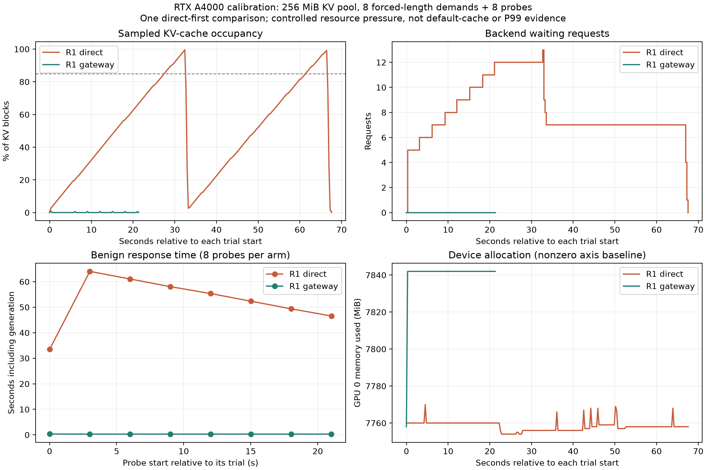

# Native-model GPU cache-pressure calibration

## Result

Under a deliberately constrained **256 MiB KV pool**, direct vLLM reached **99.559% sampled cache usage** and **13 waiting requests**. With the gateway, sampled usage peaked at **0.881%** and no waiting requests were observed. All eight benign probes completed in each arm, averaging **52.531 seconds direct** versus **0.299 seconds protected**. All eight protected demands were quarantined.

This demonstrates gateway admission protection under the recorded synthetic workload and resource budget. It does **not** isolate an advantage of adaptive over static thresholds, establish P99 latency, reproduce default-cache behavior, or measure monetary savings. The protected requests all used normal thresholds.

## Evidence and model identity

The operator supplied the [complete run JSON](evidence/native_burst_20261018/gpu_burst_calibration_native_v1.json) and [native training metadata](evidence/native_burst_20261018/lab_native_v1_metadata.json). Client commit was `b8a969e8b85823b7bd10729a0a1b860f8ff19a3b`. The run's script digest matched that committed script before subsequent runner changes. The [training/verification console](evidence/native_burst_20261018/training_console.txt) records 25 passing tests, CUDA training in 15.1 seconds and all nine smoke cases passing without serialization-version warnings.

The classifier SHA-256 is `25ea5790c5b0151e644322e1caa19329e5b8c73679b79cba4ad486c1c5ae2e05`, matching both gateway status and training metadata. Actual native artifact files have not yet been uploaded; metadata alone does not provide a restorable model snapshot. Server source revision is not exposed, so the client commit is not independent proof of server revision.

Training used 4,329 rows (2,700 benign, 994 injection, 635 exhaustion), Python 3.10.12, PyTorch 2.13.0, SentenceTransformers 3.4.1, Transformers 4.47.1, scikit-learn 1.7.2 and XGBoost 3.2.0. **98.24% is training-set resubstitution accuracy**, not held-out accuracy. The nine-case smoke suite overlaps training material and is not an independent generalization benchmark. The supplied AdvBench and Alpaca file hashes match the repository data files. This is a new model version; the old model's accuracy and GPU measurements are not reassigned to it.

## Method

The run offered eight simultaneous short output-demand requests plus eight benign probes staggered every three seconds to each arm. Demand outputs were capped at 1,792 tokens and explicitly used `ignore_eos=true`, forcing synthetic decoding to the cap. Benign outputs were capped at 16. Both paths requested temperature zero. The two 16-token benign warmups are excluded from measured totals.

The demand was a short instruction to write a 100,000-word novel, **not a 100,000-word input**. Telemetry's cache configuration confirms 268,435,456 KV bytes, **7,280 token slots**, 455 blocks of 16 tokens, and prefix caching. The reported launch protocol used maximum context 2,048, four active sequences and a 2,048-token batched-prefill cap. The cache record is direct telemetry; some launch settings rely on the operator's prescribed startup rather than independent server-config discovery.

Only one direct-first comparison was run. Prefix caches persisted between arms. Direct and protected windows differ because demands are rejected in the protected arm. GPU clocks, thermal state and unrelated GPU processes were not independently controlled. HTTP intervals include queueing, gateway work and generation, not isolated GPU execution. The API requests and exporter's reported counter increases reconcile, assuming the instructed absence of unrelated traffic.

## Verified measurements

| Measurement | Direct vLLM | Adaptive-mode gateway |
| --- | ---: | ---: |
| Demand requests offered | 8 | 8 |
| Demand requests quarantined | 0 | 8 |
| Benign completed / failed | 8 / 0 | 8 / 0 |
| Mean benign HTTP latency | 52.531 s | 0.299 s |
| Observed benign min–max | 33.478–64.038 s | 0.292–0.335 s |
| Sampled peak KV usage | 99.559% | 0.881% |
| Maximum waiting requests | 13 | 0 |
| Maximum running requests | 4 | 1 |
| Backend prompt-token counter increase | 912 | 296 |
| Backend generated-token counter increase | 14,464 | 128 |
| Backend successful-request increase | 16 | 8 |
| Observed GPU 0 allocation | 7,754–7,770 MiB | 7,758–7,842 MiB |
| Telemetry samples | 243 | 80 |

Each direct demand contributed 77 prompt tokens and 1,792 generated tokens. Benign requests contributed 37 prompt and 16 generated tokens each. Counter differences therefore corroborate avoidance of **616 backend prompt tokens and 14,336 demand-generation tokens** in the protected arm. Every trial's prompt, generated-token and successful-request delta matches its HTTP records. No telemetry errors were reported.

The ratio of measured mean benign latencies is approximately **175.6**, descriptive of this single comparison only. Eight probes per arm are insufficient for a reliable P99 or statistical effect estimate. The maximum observed latency must not be relabeled P99. Native KV usage is a fraction; percentages above multiply by 100.

Protected GPU allocation was slightly higher, not lower, despite much lower occupied KV blocks. vLLM's reserved cache allocation and gateway CUDA buffers explain why allocation and live occupancy are distinct measurements, but this run does not attribute individual allocations to components. It does not support zero overall VRAM growth, zero gateway GPU compute, OOM prevention or energy/dollar savings.

## What the dynamic-policy observations mean

During the direct arm, the idle gateway's pressure endpoint reported `high_pressure` in 36 samples. This confirms live observation/threshold-state activation while direct traffic saturated the constrained backend. No gateway-classified probe was submitted during that direct arm.

In the protected arm, all 16 request policy snapshots were `normal` (0.35/0.75 thresholds), and there were no high-pressure samples. Demand risk was about 0.994 and benign risk about 0.0069. These demands would also be quarantined by the static policy. The run supports admission protection but **does not show that dynamic threshold tightening caused the benefit**. A static negative control and a separate experiment with independently selected changed-band risks and comparable exogenous pressure are needed for that claim.

## Figures and reproduction



[SVG figure](evidence/native_burst_20261018/analysis/burst_comparison.svg) · [Per-trial CSV](evidence/native_burst_20261018/analysis/trial_metrics.csv) · [Telemetry CSV](evidence/native_burst_20261018/analysis/telemetry_trace.csv) · [Derived JSON and input checksums](evidence/native_burst_20261018/analysis/derived_summary.json)

```bash
python scripts/analyze_gpu_burst.py \
  --input reports/evidence/native_burst_20261018/gpu_burst_calibration_native_v1.json \
  --metadata reports/evidence/native_burst_20261018/lab_native_v1_metadata.json \
  --output-dir /tmp/cad-native-burst-analysis-new
```

The analysis checks classifier identity, derives backend counter deltas without replacing missing counters with zeros and retains failed-request counts. The plot's device-memory axis has a nonzero baseline explicitly labeled. All 29 CPU regression tests passed when adding this report and comparison controls; real static-control measurements remain pending.
