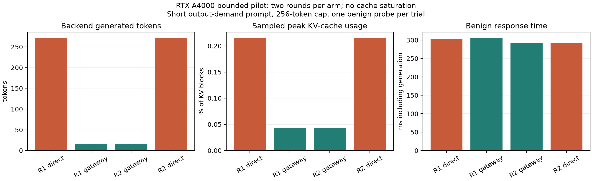

# RTX A4000 gateway protection pilot

## Result and scope

In this bounded lab pilot, the gateway rejected both short sponge-demand requests while both concurrent benign probes completed. Backend counters increased only by each benign request's tokens in the gateway trials. Direct vLLM trials generated the capped demand responses as well as the benign responses. This demonstrates avoided backend generation for these two blocked demands under the observed workload.

It does **not** demonstrate VRAM exhaustion prevention, saturated-load performance, a benefit from adaptive thresholds over a static policy, zero gateway GPU compute, or measured monetary savings. No observed queue formed and cache usage remained below 0.22%.

## Provenance and method

The operator supplied [the original pilot JSON](evidence/gpu_pilot_20261018/gpu_protection_pilot.json), produced by client commit `9ea2103e6d051b4a0c4544b7c829e5eddec497dd` on 18 October 2026. The server source revision is not exposed; the operator reports restarting it after the pull. The analysis JSON records the input SHA-256. All numerical results below are derived from the uploaded file; GPU experiments were performed on the lab machine, not in the cloud checkout.

The backend was Qwen/Qwen2.5-3B-Instruct on NVIDIA RTX A4000. Earlier startup evidence recorded FP16, maximum context 4096, four active sequences, prefix caching, memory utilization 0.75 and FlashInfer sampling disabled. The pilot itself does not independently record every server launch flag.

Each trial concurrently submitted a short request demanding a 100,000-word novel (256-token generation cap) and a benign binary-search prompt (16-token cap). This was an **output-demand** request, not a 100,000-word input. Both paths requested temperature zero. Arm order was direct/gateway in round 1 and gateway/direct in round 2. Prefix cache was retained across arms. Two benign warmups preceded the measured trials and are excluded from the measured totals.

Prometheus and `nvidia-smi` were sampled before, during and after each trial. GPU CSV includes device memory in MiB, GPU utilization and power. Sampling is approximate, not an instruction-level trace. Short gateway trials had only four telemetry samples each; direct trials had eighteen each. Missed peaks and unequal observation windows limit comparisons.

## Per-trial measurements

| Round / arm | Demand HTTP | Demand HTTP ms | Benign HTTP ms | Backend prompt-token delta | Backend generation-token delta | Backend successful-request delta | Sampled peak KV usage |
| --- | ---: | ---: | ---: | ---: | ---: | ---: | ---: |
| 1 direct | 200 | 4418.488 | 301.844 | 107 | 272 | 2 | 0.215657% |
| 1 gateway | 403 | 26.345 | 306.317 | 37 | 16 | 1 | 0.043131% |
| 2 gateway | 403 | 18.195 | 291.844 | 37 | 16 | 1 | 0.043131% |
| 2 direct | 200 | 4417.280 | 292.268 | 107 | 272 | 2 | 0.215657% |

Each direct trial's demand contributed 70 prompt tokens and 256 generated tokens; its benign request contributed 37 and 16. Each gateway trial's counter deltas match only its benign request: 37 prompt tokens, 16 generated tokens and one successful backend request. Quarantine risk was about 0.994 in both trials.

Measured backend generation totals were 544 tokens direct versus 32 gateway. The 512-token difference consists of the two blocked 256-token demand responses. Likewise, backend prompt counters differ by 140 tokens across arms. These are token counts, not calibrated GPU-seconds, energy or dollar costs. They corroborate the two blocked demand requests not reaching backend inference, assuming the instructed absence of unrelated requests.

HTTP request intervals overlapped for approximately 301.217 and 292.250 ms in direct trials, and 26.345 and 18.195 ms in gateway trials. Sampled maximum running backend requests were two direct and one gateway. HTTP overlap does not by itself prove simultaneous GPU execution; the running-request gauge provides additional scheduling evidence.

Sampled waiting requests were zero throughout. Both recorded gateway policy snapshots were fresh and normal, with 0.35/0.75 thresholds. This run did not exercise high-pressure tightening and cannot distinguish adaptive from static rejection.

## GPU memory and latency interpretation

Device memory observed across the run ranged from **12,404 to 12,412 MiB**. The first gateway trial includes an 8 MiB increase, and later direct and gateway trials share the same 12,412 MiB reading. There is no evidence of zero overall VRAM growth or an OOM event. vLLM reserves cache memory in advance; live block usage can change while device allocation stays flat.

GPU utilization samples ranged from 91% to 100% across the complete trial set. Short gateway windows retained high readings from the device's sampling interval; they cannot be interpreted as instantaneous per-request utilization or converted into reliable energy/cost savings. CUDA embeddings themselves use GPU resources.

The sampled KV-cache peak was five times lower in gateway trials, but the absolute values were only about 0.216% versus 0.043%. Unequal trial durations, retained prefixes and sampling granularity prevent interpreting this ratio as a general memory-protection factor.

Mean benign response times were **297.056 ms direct** and **299.080 ms gateway**, a descriptive difference of about 2.024 ms. Only two probes per arm were measured; no statistical latency improvement, negligible-overhead claim or reliable p99 is established. This includes backend generation and is distinct from ingress timing.



[SVG figure](evidence/gpu_pilot_20261018/analysis/pilot_comparison.svg) · [CSV measurements](evidence/gpu_pilot_20261018/analysis/trial_metrics.csv) · [Derived JSON with GPU ranges and source checksum](evidence/gpu_pilot_20261018/analysis/derived_summary.json)

## Reproduction and outstanding checks

From the repository root, reproduce the numeric derivation and figures into a fresh directory:

```bash
python scripts/analyze_gpu_pilot.py \
  --input reports/evidence/gpu_pilot_20261018/gpu_protection_pilot.json \
  --output-dir /tmp/cad-pilot-analysis-new
```

The analysis rejects counter decreases and preserves missing counters as unknown, not zero. All 18 CPU regression tests passed when adding this analysis; the analysis ran successfully against the uploaded evidence.

Before a stronger evaluation: reconcile the lab's dependency/artifact mismatches; validate full-conversation/context limits, live FP16 parity and sandbox cancellation; instrument and profile live ingress; design repeated equal-load direct/static/adaptive trials with explicit context and scheduler budgets, cache-state handling and controlled pressure. Live high-pressure behavior must be measured separately. Current live extraction results do not support the sub-5ms ingress target. No saturation, OOM or dollar-cost-savings claim should be based on this pilot.
