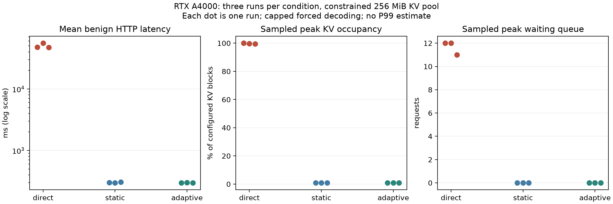

# Native GPU protection: three repetitions per condition

All nine scheduled lab runs completed with reconciled backend counters and no recorded telemetry errors. Under the controlled 256 MiB KV-cache workload, both static and adaptive gateways blocked every demand and kept benign mean HTTP latency near 0.30 seconds. Unprotected vLLM reached 99.56–100% sampled KV occupancy and benign run means of 47.39–55.63 seconds. This establishes repeatability of admission protection for this workload, not a causal advantage from adaptive thresholds.

## Design and provenance

The [prespecified protocol](GPU_REPLICATION_PROTOCOL.md) used three blocks, each containing direct, static and adaptive conditions, with balanced order. The recorded completion timestamps confirm the planned order: direct/static/adaptive, static/adaptive/direct, adaptive/direct/static. Runs occurred on 21 October 2026, approximately 12:54–13:22 IST. The operator restarted both servers between conditions. Initial exported counters were zero and the backend was idle in every file, consistent with fresh server state; process restart and all startup flags are not independently proven by those counters. Startup logs were not included in the supplied archive.

Each measured run offered eight concurrent demand requests and eight benign probes staggered every three seconds. Demands used a short natural-language output-demand prompt, a 1,792-token cap and `ignore_eos=true`; benign probes requested 16 tokens. Temperature was zero. Two fixed warmups, one per endpoint, preceded measurement and are retained separately. All warmups completed. The direct-only condition still had the static gateway running for readiness/telemetry and the excluded warmup.

The model is Qwen/Qwen2.5-3B-Instruct on the lab RTX A4000. The gateway reported native classifier SHA-256 `25ea5790c5b0151e644322e1caa19329e5b8c73679b79cba4ad486c1c5ae2e05` in every run. All recorded cache configurations agree: 268,435,456 bytes (256 MiB), 7,280 tokens, 455 blocks and prefix caching enabled. This constrained cache is not the default full-VRAM deployment.

`b1_direct` ran at client commit `cc9798d`; the other eight used `8157d32`. All nine recorded the identical benchmark SHA-256 `a7c5538b5719281124f21ba0b6fa8f8e7acb7c97d7872455925801a8ce02e920`. That intervening commit preserved artifacts and added verification/protocol files without modifying the gateway or benchmark. Server source commit was not independently exposed. The operator's first `b3_direct` invocation stopped at readiness preflight before warmup/load because vLLM was unavailable; the successful invocation is the retained result. No measured failed trial was supplied or discarded.

Exact JSON files and their SHA-256 checksums are retained under [replication_v1_20261021](evidence/replication_v1_20261021/). Historical native training metadata is retained separately; its 98.24% is training-set accuracy, not held-out accuracy or a result of these stress runs. Package versions were not independently resnapshotted for each replication.

## Per-run outcomes

| Block | Condition | Mean benign HTTP ms | Peak KV occupancy | Peak waiting queue | Demands blocked |
| --- | --- | ---: | ---: | ---: | ---: |
| 1 | Direct | 47,708.951 | 100.000% | 12 | 0/8 |
| 1 | Static | 300.618 | 0.881% | 0 | 8/8 |
| 1 | Adaptive | 297.100 | 0.881% | 0 | 8/8 |
| 2 | Direct | 55,628.927 | 99.780% | 12 | 0/8 |
| 2 | Static | 298.510 | 0.881% | 0 | 8/8 |
| 2 | Adaptive | 299.919 | 0.881% | 0 | 8/8 |
| 3 | Direct | 47,393.355 | 99.559% | 11 | 0/8 |
| 3 | Static | 306.859 | 0.881% | 0 | 8/8 |
| 3 | Adaptive | 297.136 | 0.881% | 0 | 8/8 |

All eight benign requests completed in every run, giving 24/24 per condition and zero benign failures. All direct demands generated successfully; all protected demands returned the gateway's risk-quarantine error. Direct targets above 85% were reached in all three measured runs. There were no measured unexpected outcomes or telemetry errors. Actual peak overlapping client HTTP intervals were 15, 16 and 15 direct, and nine in each protected run; offered concurrency is not simultaneous GPU execution. Peak running requests were four direct and one protected.

The mean of the three run means was 50,243.744 ms direct, 301.996 ms static and 298.052 ms adaptive. Per-block direct/protected ratios ranged from about 154 to 186, descriptive only. The range of run means, rather than individual concurrent requests treated as independent trials, describes between-run variation. Direct individual benign times ranged from approximately 291 ms to 65,869 ms; the low minimum reflects scheduling variation, not an absence of congestion.

## Backend counter reconciliation

For every run, aggregate prompt/generation/success counter deltas equal the sum of successful HTTP usage and completions. Warmups are excluded from these intervals.

| Condition | Prompt tokens per run | Generated tokens per run | Backend successes per run |
| --- | ---: | ---: | ---: |
| Direct | 912 | 14,464 | 16 |
| Static | 296 | 128 | 8 |
| Adaptive | 296 | 128 | 8 |

Each protected run avoided the direct counterpart's 616 demand prompt tokens and 14,336 generated demand tokens. Across three blocks, that is 1,848 prompt tokens and 43,008 generated tokens for **each** protected condition compared with the same three direct runs. These are workload-specific avoided backend tokens, not measured energy, dollars or GPU FLOPs. Do not add the two protection comparisons as though six separate direct controls were run.

Exported GPU allocation was 7,403–7,424 MiB across direct runs, 7,403–7,509 MiB static and 7,403–7,495 MiB adaptive. GPU allocation was not reduced to zero by quarantine; the gateway itself uses CUDA embeddings. Sampled KV occupancy and process/device allocation measure different things. Polling can miss brief peaks, and the reported allocation includes other GPU users.

## Static versus adaptive interpretation

All 48 static request decisions reported `static`; all 48 adaptive decisions reported `normal`. No protected run recorded a high-pressure policy sample or waiting queue. Each direct run recorded 36 high-pressure telemetry samples while its gateway stayed in static mode; this does not mean measured direct requests were routed adaptively.

Static-minus-adaptive benign run-mean differences were +3.518, −1.409 and +9.723 ms. Adaptive was slightly slower in block 2. These small descriptive differences, with only three repetitions, do not demonstrate statistical superiority or equivalence. The demands were already high risk under normal thresholds, so adaptive tightening was unnecessary for their rejection. The negative changed-band calibration remains unresolved.



Each dot is one run; the latency axis is logarithmic. [Exportable SVG](evidence/replication_v1_20261021/analysis/replication_comparison.svg) · [Per-run CSV](evidence/replication_v1_20261021/analysis/per_run.csv) · [Full derived summary](evidence/replication_v1_20261021/analysis/summary.json)

## Reproduce the offline analysis

```bash
MPLCONFIGDIR=/tmp/cad-mpl-cache .venv/bin/python scripts/analyze_gpu_replications.py \
  --input-dir reports/evidence/replication_v1_20261021 \
  --metadata reports/evidence/native_burst_20261018/lab_native_v1_metadata.json \
  --output-dir /tmp/cad-replication-analysis-new
```

The analyzer checks all nine run IDs, workload and mode, matching classifier metadata and benchmark hashes, and retains unexpected outcomes and counter discrepancies. Input checksums are checked before derivation. All computations and figures were produced offline from operator-supplied GPU evidence; no GPU benchmark was run in the cloud. Raw evidence is preserved, including the pre-update client commit. All 42 CPU regression tests passed, including missing-run/mode/workload/code mismatch rejection and preservation of unexpected requests and counter mismatches.

## What remains

These three repetitions per condition constitute a small engineering repeatability study, with 24 benign probes per condition. No P99 is estimated; no confidence/significance claim, zero-cost guarantee or full-VRAM/OOM claim is made. Forced capped generation is synthetic load, not a 100,000-word input or natural unbounded generation. The balanced order is not randomized/blinded; thermal, clock, other-process and prefix-cache effects are not fully controlled. Missing startup logs limit independent verification of all launch settings.

The repeated admission-protection experiment is complete. The next evaluation priority is a frozen, independently labeled held-out security/benign corpus with training-overlap checks and explicit false-positive metrics. Conversation/context and cumulative-session robustness, real timeout/cancellation semantics, ingress latency targets and an isolated pressure-conditioned mechanism test remain distinct engineering/evaluation work. Existing training accuracy and nine overlapping smoke cases cannot replace held-out evaluation.
