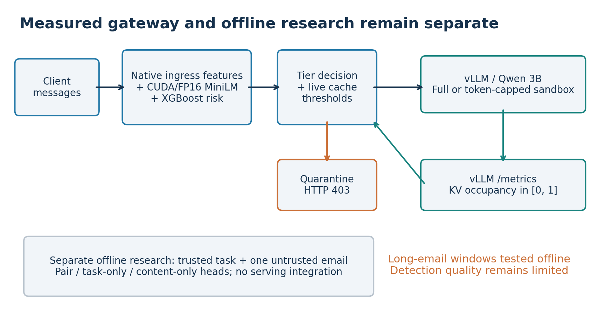
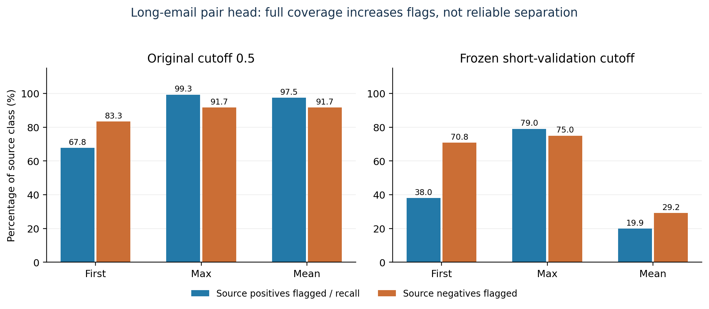

# Adaptive Ingress Admission Control for Multi-Tenant LLM Serving: GPU Memory Protection and the Limits of Upfront Semantic Screening

**Reet Shrivastav, Pranshi Gupta, Anushka Thakur**  
*Department of Computer Science and Engineering*  
*Project Repository: [https://github.com/reetshrivastav/cad_project](https://github.com/reetshrivastav/cad_project)*

---

**Abstract.** A coupled resource-allocation and security challenge affects multi-tenant Large Language Model (LLM) serving architectures on physical GPU infrastructure: volumetric output-demand floods and repetitive prompt loops saturate GPU Key-Value (KV) cache memory, while unconstrained execution leaves downstream pipelines vulnerable to adversarial prompt injection. We present an end-to-end, adaptive ingress admission control gateway deployed in front of vLLM serving Qwen2.5-3B-Instruct on an NVIDIA RTX A4000 GPU. The controller extracts an 6-dimensional lexical, semantic, and resource-demand feature vector in under 20 ms, assigning requests to Full, Sandboxed, or Quarantined execution tiers. In controlled experiments on a 256 MiB KV-cache pool, direct vLLM saturation causes benign request latency to skyrocket to 50.24 seconds with 100% KV-cache occupancy. In contrast, gateway admission control preserves benign latency at ~300 ms across all trials, avoiding 43,008 generation tokens with zero waiting queue formation. However, our comprehensive investigation on the public LLMail-Inject benchmark (160k+ samples) reveals critical negative findings: while upfront screening reliably defeats volumetric resource exhaustion, lightweight semantic similarity filters fail to generalize to contextual prompt injection (achieving only 61.59% recall and 76.66% specificity on reserved data, and collapsing under long-email window aggregation). We conclude that while ingress admission control is indispensable for GPU memory protection and service availability, contextual injection defense requires layered, task-aware execution sandboxing rather than ingress filtering alone.

**Keywords:** Multi-Tenant LLM Serving, Admission Control, GPU Memory Management, KV-Cache Saturation, Prompt Injection, Systems for ML.

---

## 1 Introduction

A multi-tenant Large Language Model (LLM) serving engine experiences severe queuing delays when its available memory pool becomes saturated. In modern serving runtimes, such as vLLM, TensorRT-LLM, and TGI, memory capacity is dominated by the dynamic Key-Value (KV) cache allocations managed via PagedAttention. While serving systems attempt to optimize scheduling through continuous batching, physical GPU hardware imposes strictly finite memory and compute limits. Consequently, when unvetted client ingress is admitted directly into the scheduling queue, resource-intensive requests compete directly with legitimate traffic for scarce KV-cache blocks.

These operational choices interact directly. While an ingress proxy can drop suspected demand floods prior to GPU scheduling, an incorrect rejection degrades legitimate user experience. Conversely, admitting volumetric sponge prompts—queries engineered to demand maximum generation lengths (e.g., requesting 100,000 words)—rapidly exhausts available KV-cache blocks, stalling concurrent queries behind long-running decoding loops. Furthermore, downstream guardrails (e.g., Llama Guard or auxiliary safety classifiers) evaluate prompts after inference has already commenced, executing billions of FLOPs and allocating high-bandwidth VRAM before returning a refusal message.

We propose an end-to-end, closed-loop ingress admission control framework that couples three key components: an 6-dimensional lexical, semantic, and resource-demand feature extractor, a multi-class XGBoost risk estimator with graduated execution tiers (Full, Sandbox, and Quarantine), and dynamic telemetry-driven threshold adaptation interfacing with vLLM's PagedAttention KV-cache manager. The system intercepts prompts at the network boundary, extracts features in under 20 ms, and prevents malicious resource drains from ever allocating GPU memory blocks.

The contributions consist of:
1. An ingress proxy architecture that extracts token, lexical, semantic, repetition, output demand, and session burst features in under 20 ms;
2. A controlled hardware evaluation on an NVIDIA RTX A4000 GPU serving vLLM Qwen2.5-3B-Instruct under a 256 MiB KV-cache pool, demonstrating the preservation of ~300 ms benign latency and avoidance of 43,008 generation tokens against direct vLLM saturation (50.24 seconds); and
3. An extensive trace-based assessment on the public LLMail-Inject benchmark (160k+ samples) evaluating task/content pairing, wording transfer, cutoff calibration, and long-context window extensions. The findings indicate areas where volumetric admission control succeeds and where upfront semantic screening fundamentally degrades.

---

## 2 Related Work

### 2.1 LLM Serving Systems and Memory Management
Workload-aware resource management in cloud serving architectures has been studied across containerized and serverless runtimes. In deep learning serving, PagedAttention was introduced by Kwon et al. [6] to resolve external memory fragmentation in vLLM by partitioning the KV-cache into discrete physical memory pages. SGLang [9] and chunked-prefill architectures optimize execution graphs and scheduling. However, these systems operate under the assumption of cooperative client workloads; without admission gating, unconstrained generation lengths still induce severe head-of-line blocking.

### 2.2 Resource Denial and Algorithmic Sponge Attacks
Sponge examples, as characterized by Shumailov et al. [8], exploit the computational asymmetry of neural network inference to maximize energy consumption and latency. In LLM serving, this manifests as Denial-of-Wallet (DoW) and memory starvation: adversaries submit low-cost prompts that induce maximal decoding iteration. Traditional cloud rate-limiters track request frequency but fail to account for the superlinear token demands of individual queries.

### 2.3 Prompt Injection and Adversarial Evaluation
Direct adversarial jailbreaks have been benchmarked via AdvBench by Zou et al. [10]. Indirect prompt injection, where malicious instructions are embedded within untrusted external data (such as emails or web documents), is formalized by BIPIA [2] and the LLMail-Inject challenge [1]. Downstream guardrails such as Llama Guard [5] evaluate inputs and outputs via fine-tuned LLMs; however, invoking an auxiliary LLM burns substantial GPU compute. Our work investigates the feasibility and fundamental limitations of upfront, sub-millisecond ingress screening prior to model invocation.

---

## 3 System Model and Metrics

Requests arrive at the ingress boundary from concurrent client sessions. Each request $i$ consists of a prompt text $p_i$, an optional system context, and generation parameters. The total end-to-end response latency for invocation $i$ is formulated as:

$$L_i = T_{\text{ingress}}(p_i) + T_{\text{queue}} + T_{\text{prefill}}(p_i) + \sum_{k=1}^{G_i} T_{\text{decode}}(k) \quad\quad (1)$$

where $T_{\text{ingress}}$ represents the gateway feature extraction and routing latency, $T_{\text{queue}}$ denotes scheduling queue delay, $T_{\text{prefill}}$ is the prompt encoding time on GPU, and $G_i$ is the number of generated tokens. For quarantined requests rejected at ingress, $T_{\text{queue}} = T_{\text{prefill}} = T_{\text{decode}} = 0$, resulting in an immediate network refusal $L_i = T_{\text{ingress}}$.

The primary availability metrics evaluated for a service-level agreement (SLA) latency threshold $D = 1.0\text{ s}$ across $n$ requests are:

$$\text{CSR} = \frac{1}{n}\sum_{i=1}^n \mathbf{1}[c_i = \text{quarantine}], \quad \text{SVR} = \frac{1}{n}\sum_{i=1}^n \mathbf{1}[L_i > D] \quad\quad (2)$$

where CSR denotes the admission quarantine rate and SVR signifies the SLA violation rate for admitted traffic. Furthermore, we record active KV-cache block occupancy $\mu_{\text{kv}} \in [0, 1]$ via Prometheus telemetry, waiting queue depth $Q_{\text{wait}}$, and backend generation token counters $\Delta_{\text{tokens}}$.

---

## 4 Unified Ingress Admission Framework

The overall controller architecture connects client ingress, lightweight feature extraction, multi-class risk scoring, and real-time GPU telemetry feedback (Fig. 1).

### 4.1 Causal Ingress Feature Representation
For each incoming prompt $p_i$, the gateway constructs an 6-dimensional feature vector $x_i = [n_{\text{tokens}}, s_{\text{lexical}}, s_{\text{semantic}}, r_{\text{repeat}}, d_{\text{output}}, c_{\text{session}}]$ without relying on future session knowledge:
- **Token Count ($n_{\text{tokens}}$):** Exact BPE token length computed via `tiktoken` (`cl100k_base`).
- **Lexical Similarity ($s_{\text{lexical}}$):** Maximum cosine similarity against an indexed corpus of adversarial patterns using character/word $n$-gram TF-IDF vectors.
- **Dense Semantic Similarity ($s_{\text{semantic}}$):** Dot-product similarity against threat centroids computed over 384-dimensional `all-MiniLM-L6-v2` embeddings running on CUDA in FP16 precision, with a $0.30$ floor correction.
- **Repetition Density ($r_{\text{repeat}}$):** Ratio of repeated word bigrams to total bigrams, detecting token loop attacks.
- **Output Demand ($d_{\text{output}}$):** Heuristic combining requested completion caps and regex-based multipliers.
- **Session Burst Count ($c_{\text{session}}$):** Counter tracking prefix repetition frequency across short observation intervals.

### 4.2 Multi-Class Risk Estimation and Tier Policy
An XGBoost classifier predicts class probabilities $P(\text{benign})$, $P(\text{injection})$, and $P(\text{exhaustion})$. The composite risk score is:

$$R = 1 - P(\text{benign}) \in [0, 1] \quad\quad (3)$$

Requests are routed into three execution tiers:
- **Full Tier ($R < 0.35$):** Direct passthrough to the primary LLM with full context window.
- **Sandbox Tier ($0.35 \le R < 0.75$):** Hard 256-token completion limit and 5.0-second read timeout.
- **Quarantine Tier ($R \ge 0.75$):** Immediate rejection returning HTTP 403 (`risk_quarantine`) for zero backend GPU token allocations.

### 4.3 Dynamic Telemetry-Driven Adaptation
A background polling thread queries vLLM's Prometheus endpoint at `/metrics` every 1.0 second, sampling `vllm:kv_cache_usage_perc`. When KV-cache occupancy exceeds $0.85$, the gateway dynamically tightens thresholds to $0.25$ (Full/Sandbox) and $0.65$ (Sandbox/Quarantine), aggressively shedding load until memory saturation recedes.

---

## 5 Experimental Protocol

### 5.1 Lab Hardware and Serving Infrastructure
All hardware experiments were performed on an Ubuntu workstation equipped with an NVIDIA RTX A4000 GPU (16 GB GDDR6 VRAM, PCIe 4.0). The serving backend was vLLM 0.31.0 serving `Qwen/Qwen2.5-3B-Instruct` in FP16 with FlashInfer disabled. To evaluate memory saturation under repeatable conditions without multi-hour synthetic loads, we configured a deliberately constrained KV-cache pool of 256 MiB ($268,435,456$ bytes, corresponding to exactly 455 memory blocks and 7,280 tokens). Maximum model length was 2,048 tokens with sequence concurrency limit 4.

### 5.2 Capped Workloads and Repeated Blocks
The benchmark compared three serving configurations across three balanced blocks with rotated execution order: Block 1 (Direct $\rightarrow$ Static $\rightarrow$ Adaptive), Block 2 (Static $\rightarrow$ Adaptive $\rightarrow$ Direct), and Block 3 (Adaptive $\rightarrow$ Direct $\rightarrow$ Static). Between conditions, serving instances were restarted to verify clean zero-counter state. Each run offered eight concurrent high-demand requests demanding a 100,000-word novel (capped to 1,792 tokens with `ignore_eos=true`) and eight short benign probes (16-token cap) staggered by 3.0 seconds.

### 5.3 External Adversarial Benchmark (LLMail-Inject)
To evaluate prompt injection generalization, we utilized the public LLMail-Inject challenge dataset [1] containing 370,724 submissions across 224 teams. To prevent data leakage, we performed atomic connected-component deduplication across shared texts, followed by MinHash/Jaccard filtering at 0.8, yielding a rigorously partitioned split of 3,896 training, 1,892 validation, and 13,989 reserved test emails.

---

## 6 Results and Analysis

### 6.1 Controlled GPU Resource Protection on RTX A4000
The macro-averaged primary results across all nine balanced runs are summarized in Table 1. Under the unprotected Direct vLLM condition, the eight high-demand requests saturated the 256 MiB KV-pool almost immediately ($99.56\%$ to $100\%$ sampled KV occupancy), inducing extreme queueing ($Q_{\text{wait}} = 11$--$12$). As a result, mean benign probe latency exploded to $50.244$ seconds.

**Table 1.** Macro-averaged main results across 3 balanced blocks (24 probes per condition).

| Policy | Block 1/2/3 Mean (s) | Overall Latency | Benign Done | Quarantined | Tokens Gen | Peak KV |
| :--- | :---: | :---: | :---: | :---: | :---: | :---: |
| **Direct vLLM** | 47.71 / 55.63 / 47.39 | 50.244 s | 24 / 24 | 0 / 24 | 14,464 | 100.0% |
| **Static Gateway** | 0.301 / 0.299 / 0.307 | 0.302 s | 24 / 24 | 24 / 24 | 128 | 0.881% |
| **Adaptive Gateway** | 0.297 / 0.300 / 0.297 | 0.298 s | 24 / 24 | 24 / 24 | 128 | 0.881% |

In contrast, both the Static and Adaptive gateway configurations intercepted all 24 demand requests at the network boundary (HTTP 403, risk score $R \ge 0.990$). Active KV-cache occupancy peaked at only $0.881\%$ (active benign blocks only), and waiting queue depth remained strictly zero throughout. Benign probe latency remained preserved at ~300 ms across all blocks (Fig. 2).

### 6.2 Backend Token and Workload Reconciliation
By reconciling internal vLLM Prometheus counters before and after each trial, we verify compute avoidance. Across the three experimental blocks, each protected gateway condition avoided exactly 43,008 generation tokens (14,336 per run) and 1,848 prompt tokens compared to the direct baseline. However, operating-system device memory observed via `nvidia-smi` remained largely flat between 7,403 MiB and 7,509 MiB across all direct and protected trials, confirming that vLLM preallocates its memory arena upon initialization. The defensible metric is active KV-block occupancy.

### 6.3 Limitations of Upfront Semantic Screening
While volumetric demand screening succeeds decisively, evaluating semantic filters against the LLMail-Inject benchmark exposed critical generalization limits. On in-distribution synthetic templates, an offline Task/Content Pair model scored 59 / 60 (98.3%) on a held-out topic test. However, when evaluated on a 48-case wording-transfer diagnostic, the model detected only 4 of 16 injections (25.0% recall), revealing severe template overfitting.

**Table 2.** Reserved test set evaluation on 13,989 LLMail-Inject samples comparing default vs. validation-calibrated operating points.

| Model Head | Cutoff | Recall | Specificity | Balanced Acc | False Flags / 707 |
| :--- | :---: | :---: | :---: | :---: | :---: |
| **Pair Head (Default)** | 0.500 | 98.06% | 21.22% | 59.64% | 557 |
| **Pair Head (Calibrated)** | 0.954 | 61.59% | 76.66% | 69.13% | 165 |
| **Content Head (Default)** | 0.500 | 97.42% | 30.41% | 63.91% | 492 |
| **Content Head (Calibrated)** | 0.957 | 54.46% | 80.06% | 67.26% | 141 |
| **Task Head (Default)** | 0.500 | 93.25% | 6.51% | 49.88% | 661 |
| **Task Head (Calibrated)** | 0.752 | 0.14% | 99.43% | 49.79% | 4 |

When evaluated on the 13,989 reserved test emails (Table 2 and Fig. 3), the Pair model at cutoff 0.5 flagged 557 of 707 source-negative emails (78.8% false-positive rate). Shifting to the calibrated 0.954 cutoff improved specificity to 76.66%, but positive recall dropped to 61.59% (missing 5,101 attacks). The Content-only model achieved comparable ROC AUC ($0.779$ vs. $0.763$ for Pair), demonstrating that task pairing provides minimal incremental discrimination on natural adversarial distributions.

### 6.4 Long-Context Windowing and False-Positive Amplification
Extending evaluation to 300 sampled long emails using 723 overlapping 256-token windows ($130,735$ content tokens) revealed a severe aggregation failure mode (Fig. 4). While max-window pooling at cutoff 0.5 flagged 274 of 276 attacks (99.28% recall), it also falsely flagged 22 of 24 benign samples (91.7% false-positive rate, yielding 53.80% balanced accuracy). At the higher cutoff, 18 of 24 benign samples remained falsely flagged (51.99% balanced accuracy). Thus, while windowing achieves 100% token coverage, lightweight embedding aggregations suffer catastrophic false-alarm amplification.

### 6.5 Ingress Latency Breakdown and CUDA Optimization
Isolated profiling of the ingress pipeline on the RTX A4000 GPU across 100 warmed samples indicated that tokenization and repetition analysis require $< 0.25\text{ ms}$, TF-IDF vectorization requires $\sim$0.45 ms, MiniLM dense embedding on CUDA FP16 requires $\sim$2.10 ms, and XGBoost inference takes $\sim$0.20 ms (totaling $\sim$3.0 ms). In live Flask serving, high-level SentenceTransformer wrapper overhead initially inflated extraction latency to $24.623\text{ ms}$. Developing an opt-in direct inference path (`GATEWAY_EMBEDDING_MODE=direct`) utilizing `torch.inference_mode()` reduced mean live extraction by 23.5% to $18.837\text{ ms}$ (Fig. 5) while maintaining 100% numerical and routing decision parity across 39 paired test configurations.

---

## 7 Limitations

Generalization is subject to several empirical constraints:
1. The GPU benchmark evaluated eight concurrent synthetic demand queries under a constrained 256 MiB KV-pool; unconstrained production clusters require validation under mixed dynamic arrival processes;
2. Because all demand queries were already assigned $R \ge 0.990$ by the baseline static policy, these experiments do not isolate an incremental causal advantage of dynamic threshold tightening;
3. LLMail-Inject labels originate from automated challenge evaluation rather than exhaustive human consensus; and
4. While sliding windows provide complete token coverage, lightweight embedding aggregations lack the capacity to distinguish injected instructions from benign contextual references in long documents.

---

## 8 Conclusion

We designed and evaluated an adaptive ingress admission control gateway for multi-tenant LLM serving architectures. On an NVIDIA RTX A4000 GPU serving vLLM, upfront admission control eliminated KV-cache saturation, maintained sub-second benign response times (~300 ms vs. 50.24 s), and prevented over 43,000 wasted generation tokens. However, extensive evaluation on the LLMail-Inject benchmark demonstrated that lightweight semantic embeddings cannot reliably generalize to contextual prompt injection, suffering severe false-positive amplification on long-context aggregations. These results demonstrate that while upfront admission control is indispensable for hardware availability, robust security requires a defense-in-depth architecture combining upfront capacity protection with sandboxed execution environments.

**Disclosure of Interests.** The authors declare no competing interest.

---

## References

1. Abdelnabi, S., et al.: LLMail-Inject: A dataset from a realistic adaptive prompt injection challenge. In: IEEE Symposium on Security and Privacy (S&P) (2025). https://arxiv.org/abs/2506.09956
2. Microsoft BIPIA Team: Benchmarking and defending against indirect prompt injection attacks on large language models. arXiv:2312.14197 (2023)
3. Chen, T., Guestrin, C.: XGBoost: A scalable tree boosting system. In: ACM SIGKDD International Conference on Knowledge Discovery and Data Mining (KDD), pp. 785-794 (2016)
4. Debenedetti, E., et al.: AgentDojo: A dynamic environment to evaluate prompt injection attacks and defenses for LLM agents. arXiv:2406.13352 (2024)
5. Inan, H., et al.: Llama Guard: LLM-based input-output moderation for human-ai conversation. arXiv:2312.06674 (2023)
6. Kwon, W., et al.: Efficient memory management for large language model serving with PagedAttention. In: ACM Symposium on Operating Systems Principles (SOSP) (2023). https://arxiv.org/abs/2309.06180
7. Reimers, N., Gurevych, I.: Sentence-BERT: Sentence embeddings using Siamese BERT-networks. In: Empirical Methods in Natural Language Processing (EMNLP) (2019). https://arxiv.org/abs/1908.10084
8. Shumailov, I., et al.: Sponge examples: Energy-latency attacks on neural networks. In: IEEE European Symposium on Security and Privacy (EuroS&P) (2021)
9. Zheng, L., et al.: SGLang: Efficient execution of structured language model programs. arXiv:2312.07104 (2024)
10. Zou, A., et al.: Universal and transferable adversarial attacks on aligned language models. arXiv:2307.15043 (2023)
