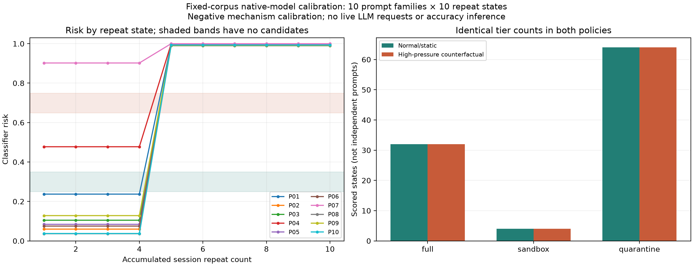

# Fixed-corpus policy-band calibration: negative result

## Findings

The native-model calibration scored ten fixed prompt families at ten accumulated session-repeat counts each. None of the **100 scored states** fell in the policy-change bands `[0.25, 0.35)` or `[0.65, 0.75)`. Normal/static and high-pressure counterfactual decisions were identical for every state.

| Tier | Normal/static | High-pressure counterfactual |
| --- | ---: | ---: |
| Full | 32 | 32 |
| Sandbox | 4 | 4 |
| Quarantine | 64 | 64 |

There were 20 distinct risk values, ranging from 0.036358 to 0.999799. These are correlated states of ten prompt families, not 100 independent prompts or labeled accuracy samples. This negative result does not prove that the bands are empty for every possible input, and does not establish adaptive superiority or inferiority.

## Provenance and validation

The operator supplied [the complete calibration JSON](evidence/policy_calibration_20261018/policy_candidate_calibration_native_v1.json), generated by client commit `ef913365d0a603ece25e92b91a9e83880931a93e`. The [console](evidence/policy_calibration_20261018/console.txt) records 32 passing lab tests and MiniLM CUDA/FP16 initialization. Python 3.10.12, Transformers 4.47.1, SentenceTransformers 3.4.1, scikit-learn 1.7.2 and XGBoost 3.2.0 match native-model metadata.

Classifier SHA-256 `25ea5790c5b0151e644322e1caa19329e5b8c73679b79cba4ad486c1c5ae2e05` matches the native training metadata. The corpus checksum `2948efe959303029e6d592024ad5104831f17ce5edd7f4b4160df45ba0b98974` reproduces from the saved prompt list. Offline analysis verifies all risk/benign-probability relationships, tier rules, band counts, unique IDs and complete repeat sequences. Input checksums are in the [derived summary](evidence/policy_calibration_20261018/analysis/derived_summary.json).

No LLM requests were made by calibration. High-pressure tiers are counterfactual calculations using thresholds 0.25/0.65; there was no real load or observed live policy decision in this experiment. The corpus and selection rule were committed before these scores were supplied. Empty bands have not been filled with invented or retrospectively selected outcomes.

## Repeat-state behavior and interpretation

All ten families retained the same risk for repeats 1–4, then jumped above 0.98 at repeat 5 and remained there through repeat 10. This accounts for 60 of the 64 quarantine states. The remaining four are the ten-thousand-word demand's first four states.

For example, the community-science-fair prompt scored 0.237088 at repeats 1–4 and 0.995691 at repeats 5–10. The concise autumn-leaves prompt moved from 0.036358 to 0.990479. This shows a strong learned response to repeated-session counts in this corpus, not by itself a measured false-positive rate or ground-truth attack detection result.

The application's `_session_repeat()` counts accumulate under a session/prompt-prefix key and have no elapsed-time window or decay. Thus the feature currently measures an accumulated count, not requests per second; real-world repeated benign use and session-isolation behavior need separate evaluation. Do not interpret these ten-state sequences as measured rapid-burst rates or independent threat labels.

The first-request sandbox candidate was `P04-S01`: “Create a structured 12-section study guide to introductory probability.” Its risk was 0.477339, placing it in sandbox under both policies. Its availability is useful for testing the existing sandbox cap, but does not resolve the empty changed-decision bands. The corpus's other apparent benign requests have no independent adjudicated labels, so no accuracy/FPR is derived.

## Figure and reproducibility



Lines join measured integer repeat states; they do not imply candidates at fractional counts between 4 and 5. [SVG](evidence/policy_calibration_20261018/analysis/policy_calibration.svg) · [All candidate scores CSV](evidence/policy_calibration_20261018/analysis/candidate_scores.csv)

```bash
python scripts/analyze_policy_calibration.py \
  --input reports/evidence/policy_calibration_20261018/policy_candidate_calibration_native_v1.json \
  --metadata reports/evidence/native_burst_20261018/lab_native_v1_metadata.json \
  --output-dir /tmp/cad-policy-calibration-analysis-new
```

All 35 CPU regression tests passed while adding this analysis and the sandbox check. No actual native-model scoring or live sandbox generation was executed in the cloud.

## Next validation

Do not alter thresholds merely to manufacture a positive comparison. A larger calibration, if justified, would need its own fixed corpus, complete retained outcomes and an explicit mechanism-test label, separate from held-out evaluation. For now the report retains the absence of observed changed-band candidates and the lack of an isolated dynamic-policy benefit.

The next concrete enforcement check is `scripts/check_sandbox_live.py`, using the already scored first-session sandbox candidate, a unique live session ID and the same model hash. It warms the idle backend with one eight-token request, then asks the gateway for 1,024 tokens with `ignore_eos=true`; correct sandbox forwarding caps the backend at 256. Response metadata now exposes the applied cap and backend read timeout on successes and failures. Classification, thresholds and timeout behavior themselves were not changed by this instrumentation.

The check records three seconds of aggregate counters after the response. An HTTP timeout is a failed generation completion, not proof of backend cancellation; exporter counters can lag. This one-request cap test does not establish a hard five-second GPU deadline, accuracy or a latency SLA. On any failure, retain the JSON and inspect the result before repeating. All other traffic must be stopped.

With vLLM running and the updated gateway restarted in adaptive mode:

```bash
.venv/bin/python scripts/check_sandbox_live.py \
  --calibration results/policy_candidate_calibration_native_v1.json \
  --output results/sandbox_validation_native_v1.json
```
